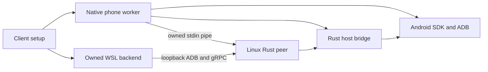

# Native phone / backend bridge

The Rust host runtime supplies an authenticated, fixed-route byte transport for a native phone and its application-owned backend. Windows can keep Android on the native host while its Linux backend retains the existing loopback ADB and emulator gRPC clients.

The only routes are ADB (`127.0.0.1:15037`) and emulator gRPC (`127.0.0.1:8558`) on the native host. The backend listeners remain loopback-only. An installer selects a private host address; wildcard, public and unresolved endpoints are rejected. There is no arbitrary destination, host shell command or Agent tool in this interface. The transport belongs on a trusted private host/backend link.

The [protobuf contract](../../../packages/protocol/proto/ai_phone/v1/host_bridge.proto) carries a version, installation-specific identity and 32-byte pairing secret. Configuration crosses stdin, never command-line arguments. One bounded admission frame authenticates each connection before any target is opened. Original ADB/gRPC bytes then flow unchanged, including HTTP/2 audio and screen streams. Secrets are not returned in the startup receipt. The bridge adds no model round trip, per-action policy layer or automatic replay.

Each listener bounds concurrent connections. Admission has a five-second deadline; continuous media is not subject to that deadline. Half-closes propagate independently. Cancellation closes listeners, aborts and joins their accepted connections, and waits for every listener before returning. A broken action stream remains subject to the runner's existing unknown-result/observation contract.

`host-resources --device-bridge` and the bundled `assistant --device-bridge` share one Rust command dispatcher and implementation. Their stdin/stdout use bounded four-byte-length-prefixed protobuf records. These are installer component interfaces, not steps end users must perform. The startup receipt establishes transport availability only; Android boot, root, authenticated frame capture, required guest applications and complete backend readiness still need their own observations.

The guest peer holds one filesystem lease and records the discovery file present before authentication. Publication rejects files created, removed or changed while pairing, including changes retaining the same owner marker. If discovery was absent, atomic create-only publication also preserves a file appearing during the write. Failed publication does not delete another writer's file. Unchanged owned metadata can be replaced on resume. The lease serializes cooperating peers; replacement of an existing file is not a filesystem-wide compare-and-swap against arbitrary concurrent writers.

## Native lifecycle and automatic pairing

The Windows bootstrap initializes its owned WSL backend before starting the native phone worker with the selected distribution. That worker owns the SDK processes, host bridge and `wsl.exe` guest peer. Detaching the setup UI or changing the focused device does not own their lifetime. A native worker resuming the same phone re-observes the paired backend instead of starting another peer or trusting a saved ready flag.

`--phone-peer-contract` reports `ai-phone-phone-peer-v2`; the wire frame version remains 1. The native worker queries this existing capability entry before sending new commands or launching the phone. An older installed bootstrap is refused with an upgrade-required result. This does not implement an in-place WSL upgrade.

The native worker selects its private host interface from the observed guest address; matching host/guest addresses select loopback. NAT and mirrored WSL networking have different host-access behavior, documented by [Microsoft](https://learn.microsoft.com/en-us/windows/wsl/networking). This selection policy is covered by tests; actual Windows adapter/firewall and WHPX behavior remain unqualified. Global WSL or firewall settings are not changed.

Pair identity is stored separately from ephemeral endpoints. The worker reads the SDK token from its private advertisement directories and supplies the pair secret/token through stdin. A managed Unix guest uses a cancellable owner pipe: EOF or owner control ends the peer, drains its streams and removes only its unchanged advertisement. SIGTERM also completes while that pipe remains open. Detached component callers retain the default behavior; Windows is the native owner, not a managed guest-peer platform.

`--phone-guest-address` and `--phone-peer-status` are private protobuf installer observations. The latter requires the expected pair identity and current advertisement, then reads boot/root identity and a real screenshot through guest ADB. Its `backend_paired` result proves a paired transport observation, not installed applications, notification delivery, desktop readiness or complete product installation. A missing or conflicting pair cannot report ready.

## Runner ADB transport

The phone Runner and native boot observer share `ai-phone-adb`, a Rust client for
the existing loopback ADB server. Shell commands use ADB shell v2 with separate
stdout, stderr and the remote exit code; screenshots retain their raw binary
stream. This removes the Runner's per-command ADB process and its
`AI_PHONE_ADB` executable override. The model-facing API remains protobuf.
The implementation follows the upstream [ADB services](https://android.googlesource.com/platform/packages/modules/adb/+/refs/heads/main/docs/dev/services.md)
and [shell protocol](https://android.googlesource.com/platform/packages/modules/adb/+/master/shell_protocol.h).

Each operation selects the exact serial and keeps the caller's output and time
budgets. A truncated response, missing shell exit or timeout cannot become a
successful action. Cancellation drops the connection; the Runner retains its
action ledger, control epoch and unknown-result handling. No command is retried
by the client. The native SDK still owns the host ADB server, and remaining
media/setup paths still require their documented SDK tools; this change does
not finish Windows first-run integration.

## Qualification and remaining integration

The component has actual two-route transfer, half-close, invalid-credential, frame-boundary and cancellation tests. Maintainer validation also ran a separately compiled Linux Rust process against an existing native Android instance, reading root identity and a real PNG through the bridge. A temporary guest tone produced nonzero gRPC PCM through the native bridge. No accounts, conversations or device disks are inputs to the distributed component.

The WSL factory supplies the Linux x64 ADB tools and AOSP emulator schema at the backend's configured SDK root. The native lifecycle now calls the automatic pairing path. Maintainer checks paired, observed, disconnected and resumed the current Rust owner and Linux peer twice against an actual Android; the existing media consumer also returned valid PNGs. Wrong pair observations and observations after shutdown were rejected, with owned work and pair identity retained.

Windows WHPX/WSL integration, complete phone/desktop provisioning and first-run readiness still need qualification. The complete-install checkpoint and Windows independent-host capability remain disabled. The current native migration candidate still requires consolidated qualification.

## 中文

Rust 桥接组件只转发原生手机的 ADB 与模拟器 gRPC，两条路由固定，客体监听保持本机回环。安装器通过标准输入传入 protobuf 配置和独立配对密钥；每个连接只核验一次，不增加模型调用、逐动作设卡或自动重放。取消时关闭监听并等待全部连接退出，未知动作结果仍由原 Runner 的观察/回执机制处理。

原生手机工作进程已持有自动配对，前台窗口与设备焦点不决定其生命周期。受管 Unix 客体随父管道结束而清理，SIGTERM 也可在管道仍打开时正常退出；旧 bootstrap 在新命令发出前由 v2 能力检查拒绝。当前 Rust 主客体已对真实 Android 完成两次配对、root/画面观察、断开和恢复，保留隔离工作文件与配对身份；错误身份和断开后的观察均拒绝就绪。Windows 实机与扬声器播放待测。现有 WSL 原地升级尚未实现。
